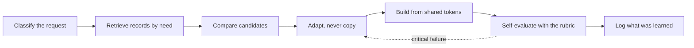

<div align="center">

# VIXEN

**Universal design intelligence for AI agents**

Pick patterns by need. Adapt, don't copy. Measure the result.


[What it is](#what-it-is) · [Install](#install) · [How it works](#how-it-works) · [The dataset](#the-dataset) · [Tools](#tools) · [Layout](#repository-layout) · [Roadmap](#roadmap)

</div>

---

## What it is

VIXEN helps an AI agent understand *why* designs work, so the result fits the project instead of one generic style.

It is **not** a UI kit, a prompt pack or a screenshot gallery. It has three parts:

| Part | What it does |
|---|---|
| **Dataset** | Analyzed concept designs, each with measured contrast, scores, components, build effort and failure modes |
| **Method** | An agent protocol: classify, retrieve by need, compare, adapt, build from shared tokens, self-evaluate |
| **Skill** | `SKILL.md`, the entry point that teaches an agent the method and points it at the dataset |

> **Status: pre-release.** The dataset is the focus. `SKILL.md` is a first version and has not been tested in an agent. See [Roadmap](#roadmap).

---

## Install

```
npx skills add LONERXONE-ops/vixen
```

| Step | Result |
|---|---|
| Source is found and cloned | Verified |
| The skill `vixen` is detected and its description is read | Verified |
| Installing into an agent | Not yet tested |
| An agent actually using the skill on a real task | Not yet tested |

If the installer fails for you, use the manual route:

```
git clone https://github.com/LONERXONE-ops/vixen.git
```

Then point your agent at `SKILL.md` and `dataset/dataset-guidelines.md`.

---

## How it works



1. **Classify** what is being built, for whom, under which constraints. No style yet.
2. **Retrieve by need, not by look.** Match the request against each record's `use_when` and `avoid_when`.
3. **Compare** candidates by score, `failure_modes` and build effort.
4. **Adapt.** Keep `must_preserve`, change `free_to_vary`. Never reproduce a source design's surface.
5. **Build from one token set** so all components feel like one product.
6. **Self-evaluate** with the rubric, including measured contrast. Fix critical failures.
7. **Log** real adaptations so the owner can promote lessons into the dataset.

The full protocol is in [`dataset/dataset-guidelines.md`](dataset/dataset-guidelines.md).

---

## The dataset

46 records, `vixen-ui-001` to `vixen-ui-046`, from four batches of concept designs.

| Records | Schema | State |
|---|---|---|
| `001` to `009` | v1 | No scores or components. Being upgraded. |
| `010` to `019` | v2.0 | Scored. Being upgraded. |
| `020` to `046` | v2.1 | Current standard |

Concepts so far cover navigation, profile and talent cards, landing and hero pages, dashboards, onboarding, widgets and product pages.

### What a record holds

```
measured          palette, contrast ratios sampled from the image
observed          visible facts only
interpretation    inferences, kept apart from facts
concept_work      what makes it work, what is missing
components        parts and what each connects to
system            shared tokens and the links between components
build             effort (Low / Medium / High) and risks
pattern           use_when, avoid_when, must_preserve, free_to_vary, failure_modes
evaluation        rubric scores, critical failures, readiness
```

### Families

Records of the same component are compared in `dataset/families/`:

- `profile-card.md`
- `landing-hero.md`

Family pages are drafts until reviewed. Treat their guidance as hypotheses.

### Integrity rules

- Observed facts stay separate from interpretation. Design intent is never invented.
- `creator`, `source` and `publication_date` are `null`, and `license` is `"unknown"`, until evidence is supplied. Text visible in an image is not proof of authorship.
- Third-party content (logos, characters, photos, brands) is listed per record.
- Accessibility is measured from the image, never estimated. Values within 0.4 of a threshold are flagged `near_threshold`.
- Source images are **not** stored in this repository.

---

## Evaluation

Every record is scored with [`evaluation/concept-rubric.md`](evaluation/concept-rubric.md) (v1.1).

| Category | Weight | Basis |
|---|---|---|
| Purpose and requirements | 15 | judged |
| Visual quality and composition | 20 | judged |
| Discipline-specific correctness | 20 | judged |
| Usability and functionality | 15 | judged |
| Consistency and coherence | 10 | judged |
| Originality and creative direction | 10 | judged |
| Accessibility and inclusivity | 10 | **measured** |

Readiness: **A** is 80 or more, **B** is 60 to 79, **C** is below 60. Any critical failure caps the total at 69. Scores describe a concept as shown in a static image. Behavior and states that are not shown are not scored.

---

## Tools

Used to build the dataset. You do not need them to use it.

Requires Python 3 with `numpy` and `Pillow`:

```
pip install numpy pillow
```

| Tool | Purpose |
|---|---|
| `tools/contrast.py` | Measure contrast from boxes drawn on an image; draws a verification montage |
| `tools/evaluate.py` | Build the evaluation block |
| `tools/gen_example.py` | Template for generating records |
| `tools/validate_records.py` | Check every record for completeness and consistency |

Details: [`tools/README.md`](tools/README.md).

---

## Repository layout

```
SKILL.md                     agent skill entry point
README.md
CHANGELOG.md                 project changes
dataset/
  dataset-guidelines.md      schema, agent protocol, learning loop
  records/                   one JSON per concept, plus INDEX.md
  families/                  comparisons of records of one component
  learning/                  template for logging real adaptations
evaluation/
  concept-rubric.md          scoring rules
  CHANGELOG.md               rubric changes
  PROPOSALS.md               proposals (see file)
tools/                       measurement, evaluation, validation
```

---

## Roadmap

- [x] Repository and identity
- [x] Dataset batches 1 to 4 (46 records)
- [x] First `SKILL.md`
- [ ] Upgrade records `001` to `019` to schema 2.1
- [ ] Grow the dataset toward 100+ concepts
- [ ] Derive `knowledge/` from the dataset (color, typography, composition, spacing, accessibility)
- [ ] Derive `core/` (philosophy, reasoning, adaptation) and `workflows/`
- [ ] Rewrite `SKILL.md` from `knowledge/` and `core/`
- [ ] Test the install and the skill in real agents
- [ ] First public release

---

## Contributing

Concepts are reviewed by a person before entering the dataset. A strong candidate shows an idea beyond a stock pattern, shows more than one state or theme, has a known creator and source, and belongs to a component family. Weaker or flawed concepts are welcome too, because the dataset should also teach what fails. Include the creator and source when you know them.

---

## License

No license has been chosen yet. Until one is added, all rights are reserved by the repository owner. Analyzed concept designs remain the property of their creators and are not redistributed here.
